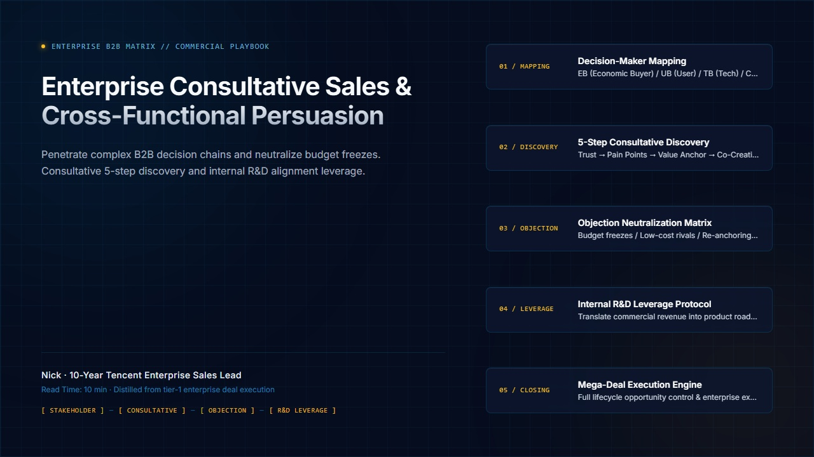
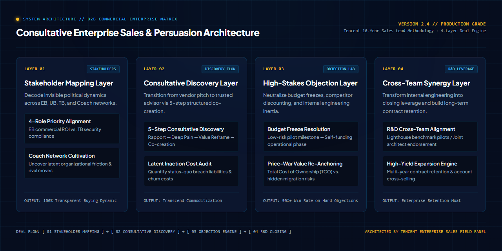

<div align="right">
  <a href="README_zh.md">简体中文</a> | <b>English</b>
</div>

<div align="center">



# Consultative Enterprise Sales & Persuasion Playbook
### Grounded in 10-year Tencent Enterprise Sales lead Nick's multi-million dollar field mentorship

**Penetrate enterprise stakeholder networks, master 5-step consultative discovery, resolve budget freezes, and leverage internal R&D alignment.**

<p align="center">
  <a href="https://github.com/Daokexun/enterprise-sales-persuasion-playbook/stargazers"></a>
  <a href="LICENSE"></a>
  <a href="llms.txt"></a>
  <a href="cli/objection_simulator.py"></a>
  <a href="cheatsheets/meddppicc_deal_matrix.svg"></a>
  <a href="CONTRIBUTING.md"></a>
</p>

</div>

---

### 📖 Editorial Background

> **"Enterprise B2B sales is never about pitching features or software widgets; it is empowering the internal client champion to win their internal political and commercial agenda."**  
> — Nick · 10-Year Tencent Enterprise Sales Lead (EP14)

In complex multi-million dollar enterprise commercial negotiations, sales and solution engineering teams face three critical bottlenecks:

1. **The Feature Pitch Trap**: Reps pitch product specs to technical buyers without ever understanding the Economic Buyer's P&L drivers or the organizational Cost of Inaction (COI).
2. **Objection Paralysis**: Crumbling under standard enterprise resistance ("We built an in-house tool", "Your competitor is 40% cheaper", "Our CFO froze budgets").
3. **Internal Friction**: Treating internal engineering and product teams as delivery vendors rather than aligning commercial incentives into a unified closing force.

This repository codifies the field-tested consultative sales methodology used across Tier-1 enterprise organizations: **MEDDPPICC Deal Governance, 5-Step Consultative Discovery, High-Stakes Objection Defense Labs, and Cross-Team R&D Leverage**.

---

### ⚡ Instant CLI Objection Defense Simulator

Simulate high-stakes enterprise objections in under 15 seconds:

```bash
# 1. Clone repository
git clone https://github.com/Daokexun/enterprise-sales-persuasion-playbook.git
cd enterprise-sales-persuasion-playbook

# 2. Run instant objection drill (Feature Pitch vs. Consultative Trusted Advisor)
python cli/objection_simulator.py --simulate-objection
```

---

### 🏛️ Four Core Pillars

| Pillar | Strategic Purpose | Core Execution Mechanism |
| :--- | :--- | :--- |
| **01 Stakeholder Mapping Matrix**<br>`prompts/01_decision_maker_mapping.md` | Uncover organizational buying centers and political dynamics | Maps Economic Buyers (EB), User Buyers (UB), Technical Gatekeepers (TB), and internal Coaches. |
| **02 5-Step Consultative Discovery**<br>`prompts/02_consultative_discovery_loop.md` | Transition from vendor pitch to trusted strategic advisor | 5-step framework: Provocative Insight → Latent Pain → Value Reframing → Co-creation → Mutual Action Plan. |
| **03 High-Stakes Objection Defense**<br>`prompts/03_high_stakes_objection_resolution.md` | Neutralize budget freezes and competitor discounting | Re-anchors conversations to 3-year Total Cost of Ownership (TCO), maintenance developer capacity, and downtime risk. |
| **04 Cross-Team R&D Leverage**<br>`prompts/04_cross_team_rd_leverage.md` | Transform internal engineering into your closing force | Bridges commercial realities with engineering roadmaps through lighthouse pilots and joint architect endorsements. |

---

### 📐 System Architecture Matrix

The following diagram illustrates the 4-layer commercial deal matrix:

<div align="center">
  
</div>

---

### 🌲 MEDDPPICC Deal Matrix & 1-Page Cheatsheet

Downloadable high-density printable vector artifacts for rapid review:
- 📄 **1-Page Cheat Sheet**: [`cheatsheets/b2b_sales_cheatsheet.md`](cheatsheets/b2b_sales_cheatsheet.md) (MEDDPPICC inspection scorecard, 3 objection re-anchors)
- 📊 **Vector Deal Matrix**: [`cheatsheets/meddppicc_deal_matrix.svg`](cheatsheets/meddppicc_deal_matrix.svg)

<div align="center">
  
</div>

---

### 🥊 Tactical Breakdown: Feature Vendor vs. Consultative Trusted Advisor

| Client Pushback | Feature Vendor Pitch (Defensive) | Consultative Trusted Advisor (Value Reframe) |
| :--- | :--- | :--- |
| **"Our engineering team already built an in-house tool; we don't need third-party vendors."** | Defensive argument: "Our tool has 50 more features, a much nicer UI, and we update weekly. Your in-house tool is outdated." | **Capacity Re-Anchoring**: "That proves how critical this problem is that you committed engineering headcount. Typically, engineering leaders tell us that maintaining custom internal tooling consumes 15-20% of senior developer bandwidth on bug fixes rather than customer-facing revenue features. If we offloaded that maintenance burden while preserving full API extensibility, would it be worth evaluating what that 20% capacity reallocation looks like on your Q4 product roadmap?" |
| **"Your competitor is 40% cheaper on license price."** | Panic discount: "We can ask our VP for a special discount to match their price if you sign today." | **TCO & Outage Insurance**: "If license price were the only factor, that competitor would be the only vendor in the market. When enterprise clients choose our architecture, they aren't paying for software licenses; they are insuring against the $250k/hour downtime risk and hidden migration maintenance costs. Let's compare 3-year Total Cost of Ownership." |

---

### 🤖 AI Coding Agent Integration (`llms.txt`)

This repository is optimized for autonomous coding agents (Claude Code, Cursor, GitHub Copilot).
- **Curated Rules**: Feed [`llms.txt`](llms.txt) to your AI agent to audit your enterprise sales proposals and objection handling scripts.
- **Full Specification**: Reference [`llms-full.txt`](llms-full.txt) for MEDDPPICC deal qualification rubrics.

---

### 📂 Repository Structure

```text
enterprise-sales-persuasion-playbook/
├── assets/
│   ├── hero_poster_en.jpg           # Sovereign Navy English publication banner (1280x720)
│   ├── hero_poster_zh.jpg           # Chinese publication banner (1280x720)
│   ├── architecture.png             # 1280x640 High-Density Commercial Architecture Blueprint
│   └── architecture_zh.png          # 1280x640 Chinese Commercial Blueprint
├── cheatsheets/
│   ├── b2b_sales_cheatsheet.md      # 1-page high-density quick reference (MEDDPPICC)
│   └── meddppicc_deal_matrix.svg    # Printable vector MEDDPPICC deal matrix
├── cli/
│   └── objection_simulator.py       # Interactive CLI High-Stakes Objection Simulator
├── prompts/
│   ├── 01_decision_maker_mapping.md # Stakeholder mapping matrix (EB/UB/TB/Coach)
│   ├── 02_consultative_discovery_loop.md # 5-step consultative discovery loop
│   ├── 03_high_stakes_objection_resolution.md # High-stakes objection resolution lab
│   └── 04_cross_team_rd_leverage.md # Cross-team R&D leverage & deal rooms
├── templates/
│   └── meddppicc_scorecard.json     # Enterprise deal qualification scoring template
├── evals/
│   └── rubric_100_sales_persuasion.json # 100-point consultative sales audit matrix
├── llms.txt                         # Curated AI Agent specification
├── llms-full.txt                    # Comprehensive specification
├── README.md                        # English documentation (current file)
└── README_zh.md                     # Chinese documentation
```

---

### 🌟 Star History & Community

<p align="center">
  <a href="https://star-history.com/#Daokexun/enterprise-sales-persuasion-playbook&Date">
    
  </a>
</p>

### 📄 License & Community

This project is open-sourced under the [MIT License](LICENSE). Contributions from enterprise account executives, solutions architects, and consultative sales leaders are welcomed via [CONTRIBUTING.md](CONTRIBUTING.md).
