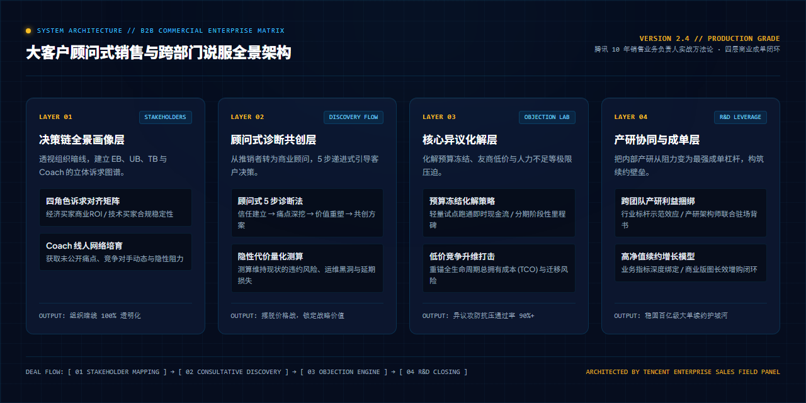
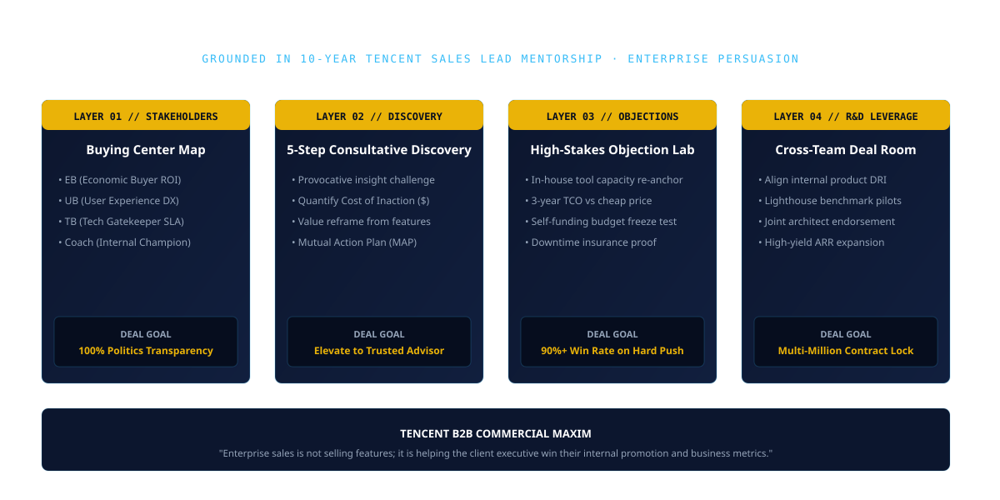

<div align="right">
  <b>简体中文</b> | <a href="README.md">English</a>
</div>

<div align="center">

<a href="assets/hero_motion_demo.mp4">
  
</a>

<p align="center">
  <em>⚡ 实战动态推演：三维全景 MEDDPPICC 商机作战指挥舱、决策链向量咬合、大单推进速度可视化</em>
  <br>
  <a href="assets/hero_motion_demo.mp4">▶ <b>观看完整 10 秒 60fps 高清动态视频 (assets/hero_motion_demo.mp4)</b></a> · <a href="assets/hero_poster_zh.jpg">🖼 静态彭博深蓝海报</a>
</p>

# 大客户顾问式销售与跨部门说服实战
### Consultative Enterprise Sales & Persuasion Playbook

**沉淀自腾讯 10 年一线销售业务负责人 Nick 实战心法 · 穿透企业复杂决策链，化解百亿级高压异议与撬动产研共赢**

<p align="center">
  <a href="https://github.com/Daokexun/enterprise-sales-persuasion-playbook/stargazers"></a>
  <a href="assets/hero_motion_demo.mp4"></a>
  <a href="LICENSE"></a>
  <a href="llms.txt"></a>
  <a href="cli/objection_simulator.py"></a>
  <a href="cheatsheets/meddppicc_deal_matrix.svg"></a>
  <a href="CONTRIBUTING.md"></a>
</p>

</div>

---

### 📖 导读与实战背景

> **“大客户销售不是去推销产品功能，而是帮客户的业务负责人赢得他的内部政治与商业目标。”**  
> —— Nick · 腾讯 10 年一线销售业务负责人（鹅厂卧谈会 EP14）

在百亿级大客户成单与复杂组织协同中，销售、售前架构师与商务团队往往深陷三大瓶颈：

1. **“推销产品，见不到拍板人”**：只懂罗列产品功能参数，找不到经济买家（EB）的真实诉求，困死在基层技术采购流程中；
2. **“异议面前手足无措”**：面对客户“自研系统已够用”、“友商报价便宜40%”、“集团预算全部冻结”等极限施压时，只会打折让利；
3. **“跨部门协同内耗严重”**：把内部研发和产品团队当“下包外包”，缺乏利益捆绑与标杆示范机制，导致交付卡点频发。

本手册源于腾讯 10 年大客户销售老兵的实战沉淀，系统拆解**决策链穿透画像、顾问式 5 步诊断法、核心异议化解矩阵与跨部门产研协同协议**，助力攻克大体量商业单。

---

### ⚡ 15 秒开箱实测 CLI

本地无需繁琐配置，终端直接体验三大高压异议的攻防推演：

```bash
# 1. 克隆代码仓库
git clone https://github.com/Daokexun/enterprise-sales-persuasion-playbook.git
cd enterprise-sales-persuasion-playbook

# 2. 运行对比评测：普通推销让利 vs 顾问式专家重锚商业代价
python cli/objection_simulator.py --simulate-objection
```

---

### 🏛️ 四大核心支柱 (Core Capabilities)

| 模块 | 核心解决问题 | 一线实战落地打法 |
| :--- | :--- | :--- |
| **01 决策链穿透画像**<br>`prompts/01_decision_maker_mapping.md` | 穿透复杂科层制，绘制组织暗线网络 | 精准定位经济买家 (EB)、使用者 (UB)、技术把关人 (TB) 与内部线人 (Coach)，理清不同角色的核心利益诉求。 |
| **02 顾问式 5 步诊断法**<br>`prompts/02_consultative_discovery_loop.md` | 摆脱推销标签，与客户高层平等对话 | 信任建立 → 痛点深挖 → 价值重塑 → 共创方案 → 承诺闭环，挖掘客户未言明的隐性商业代价。 |
| **03 核心异议化解矩阵**<br>`prompts/03_high_stakes_objection_resolution.md` | 化解“预算冻结”、“友商低价”极限施压 | 预算冻结以轻量试点跑通即时现金流；低价竞争重锚全生命周期拥有成本 (TCO) 与隐性业务中断风险。 |
| **04 跨部门产研协同协议**<br>`prompts/04_cross_team_rd_leverage.md` | 把内部研发转化为成单合力 | 将商业大单包装为行业标杆案例，绑定产品技术团队的晋升与业务战功，形成利益共同体。 |

---

### 📐 业务全景系统架构

下图展示了从商机线索输入到最终成单与跨部门交付的完整闭环流程：

<div align="center">
  
</div>

---

### 🌲 MEDDPPICC 商业成单矩阵与一页纸速查卡

配备高清可打印矢量图与速查清单：
- 📄 **一页纸核心速查卡**：[`cheatsheets/b2b_sales_cheatsheet.md`](cheatsheets/b2b_sales_cheatsheet.md)（MEDDPPICC 评估打分卡、三大高压异议重锚策略）
- 📊 **矢量商业成单矩阵**：[`cheatsheets/meddppicc_deal_matrix.svg`](cheatsheets/meddppicc_deal_matrix.svg)

<div align="center">
  
</div>

---

### 🥊 实战攻防对比：普通推销 vs 顾问式专家

| 客户施压场景 | 普通推销的被动应对 | 顾问式专家的重构破局 |
| :--- | :--- | :--- |
| **“我们内部技术团队已经自研了这套系统，不需要买外部产品。”** | 拼命比对功能：“我们的产品功能更多，界面更好看，每周都迭代，你们自研的很简陋……” | **研发人力与核心产能重锚**：“这恰恰证明该痛点在贵司有多关键。但自研往往长期占用核心研发 15-20% 的带宽做日常运维。若我们能替您接管繁杂维护并保留全面 API 扩展能力，帮研发团队释放 20% 产能全力投入 Q4 核心商业目标，您是否愿意一起评估这笔产能账？” |
| **“某友商的产品跟你们差不多，报价比你们低 40%。”** | 惊慌让利：“如果您今天能签，我去向领导申请一个特殊折扣，也可以给您降价。” | **总拥有成本 (TCO) 与宕机保险**：“如果只看软件授权费，友商确实便宜。但大客户选择我们，买的从来不是几张 License，而是给每小时数十万损失的业务买一份高可用保险。如果把迁移成本、运维黑洞和潜在故障风险算进去，我们可以客观算一笔 3 年期总拥有成本（TCO）。” |

---

### 🤖 AI Coding Agent 原生就绪 (`llms.txt`)

本项目全面适配 Claude Code、Cursor、GitHub Copilot 等 AI 编程助手：
- **精选上下文规则**：将 [`llms.txt`](llms.txt) 引入 Cursor 规则库，自动审查你的商业方案与跨部门沟通话术。
- **全量成单规格**：参考 [`llms-full.txt`](llms-full.txt) 模拟大客户高层对你的提案进行现场压力挑战。

---

### 📂 目录结构全览

```text
enterprise-sales-persuasion-playbook/
├── assets/
│   ├── hero_motion_demo.mp4         # 10 秒 60fps 高清 MEDDPPICC 商机作战指挥舱动态演示视频
│   ├── hero_motion_preview.gif      # 轻量级循环动效预览图 (兼容所有 Markdown 渲染)
│   ├── hero_poster_en.jpg           # 彭博深蓝英文技术封面海报 (1280x720)
│   ├── hero_poster_zh.jpg           # 中文技术封面海报 (1280x720)
│   ├── architecture.png             # 1280x640 全景商业架构蓝图
│   └── architecture_zh.png          # 1280x640 中文架构蓝图
├── cheatsheets/
│   ├── b2b_sales_cheatsheet.md      # 一页纸速查卡 (MEDDPPICC 打分卡与异议重锚)
│   └── meddppicc_deal_matrix.svg    # 可打印矢量 MEDDPPICC 成单矩阵
├── cli/
│   ├── objection_simulator.py       # 交互式高压异议化解推演命令行工具
│   └── sales_call_analyzer.py       # Gong 43:57 通话发言比与采购信号探测器
├── playbooks/
│   └── b2b_objection_battlecards.json # 机器可读 B2B 异议化解作战卡库
├── prompts/
│   ├── 01_decision_maker_mapping.md # 决策链穿透画像工作台
│   ├── 02_consultative_discovery_loop.md # 顾问式 5 步诊断法
│   ├── 03_high_stakes_objection_resolution.md # 核心异议化解矩阵
│   └── 04_cross_team_rd_leverage.md # 跨部门产研协同协议
├── skills/
│   └── meddppicc-deal-auditor/
│       └── SKILL.md                 # GitLab 公开销售指南 MEDDPPICC 资格审查技能
├── templates/
│   ├── command_of_the_message_matrix.md # Force Management 价值交付 4 栏矩阵
│   └── meddppicc_scorecard.json     # 大客户商机成单资格打分模板
├── evals/
│   └── rubric_100_sales_persuasion.json # 100 分制顾问式说服评鉴基准
├── llms.txt                         # AI Agent 规范
├── llms-full.txt                    # 完整规范
├── README.md                        # 英文说明文档
└── README_zh.md                     # 中文说明文档 (当前文件)
```

---

### 🌟 Star History & 社区

<p align="center">
  <a href="https://star-history.com/#Daokexun/enterprise-sales-persuasion-playbook&Date">
    
  </a>
</p>

### 📄 开源许可证与贡献

本项目采用 [MIT License](LICENSE) 开源。欢迎各大厂大客户销售总监、解决方案架构师及商务伙伴共同参与共建，详见 [CONTRIBUTING.md](CONTRIBUTING.md)。
