<p align="center">
  
</p>

<div align="center">

[English](README.md) • **简体中文**

[](LICENSE)
[](SKILL.md)
[](#-商业说服的三大-gtm-战略基石)
[](evals/rubric_100_sales.json)
[](CONTRIBUTING.md)

<p align="center">
  <b>“人人都是销售，职场处处是说服。”——无论做技术、产品还是运营，拉资源、推方案本质上都是在做销售。</b><br>
  别再搞自嗨式宣讲与单向乞求。基于腾讯营销渠道 10 年大单专家 Nick 亲授实操体系，用“KP决策链诊断、顾问式销售五步法、异议拆弹谈判矩阵与跨部门资源撬动”，构建顶级商业说服全栈影响力。
</p>

[GTM 理念](#-什么是顾问式销售与说服的-go-to-market-gtm-策略) • [三大战略基石](#-商业说服的三大-gtm-战略基石) • [四步落地路线](#-四步打造商业说服力与大单闭环gtm-实施路线) • [实战真实对比](#-实战真实对比自嗨推销推土机-vs-本工具顾问式大单说服方案) • [极速上手](#-30秒极速上手) • [系列架构](docs/ARCHITECTURE.md)

---

</div>

## 🎯 什么是顾问式销售与说服的 Go-to-Market (GTM) 策略？

> **“Think of a go-to-market strategy as the north star that guides your product launch.”**  
> —— 亚马逊官方 GTM 指南

无论在对外商务谈判还是在对内跨部门协作中，绝大多数人都在犯同样的错误：**“喋喋不休地推销自己的产品有多厉害、代码写得有多好，却从来不问对方真正需要什么、考核指标卡在哪里。”**

结果呢？客户觉得你在强买强卖，礼貌回复“我们再考虑考虑”；开发和合作部门觉得你在甩锅加戏，冷冰冰地回复“排期已满，下季度再说”。

**顶级的说服力，是一场严密的商业 GTM 战役：**
1. **摸透决策链与真实痛点（Understand Your Audience）**：认清谁是掏钱拍板的经济买家，谁是把关人。对方当期最怕什么风险？最想拿什么政绩？
2. **站位顾问，创造价值共振（Understand Value Alignment）**：先利他，把你的产品能力翻译成对方能拿来升职加薪、降本增效的利器。
3. **拆弹异议，推动闭环（Connect & Close）**：遇到拒绝别慌，异议才是成交的真正起点；用极低试错成本的 PoC 试点锁定长期战略同盟。

**`enterprise-sales-persuasion-playbook`** 将腾讯核心渠道大单专家 Nick 的 10 年一线实战经验沉淀为标准化 Agent 引擎。

---

## 🏛️ 商业说服的三大 GTM 战略基石

| 战略基石 | 核心操盘抓手 | 落地价值与产出 |
| :--- | :--- | :--- |
| **1. 洞察 KP 决策链<br/>(Decision Mapping)** | 穿透组织架构，找准经济买家、技术把关人与使用者，解码核心 KPI 利益链。 | 彻底杜绝在非决策人身上空耗几个月，直捣核心决策中枢，缩短 70% 成交周期。 |
| **2. 顾问式销售五步动线<br/>(5-Step Consultative)** | 落地破冰建信、SPIN 提问、价值匹配、异议排解与试点促成五大递进阶段。 | 把讨嫌的单向推销转变为高阶咨询陪伴，让客户自发得出“必须跟你们合作”的结论。 |
| **3. 跨部门利益捆绑<br/>(Cross-Team Leverage)** | 把内部合作方（研发/法务/设计）当核心客户，在项目立项前为对方预留专属战功与成果。 | 跨部门排期阻力化为乌有，调动团队王牌资源共同打下高难度战略大单。 |

---

## 🔄 四步打造商业说服力与大单闭环：GTM 实施路线

<p align="center">
  
</p>

### 📍 Step 1. KP 决策链诊断 (Decision Mapping)
- **绘制决策权力图谱**：精准标明 Economic Buyer（预算批复人）、Gatekeeper（风控/技术把关人）与 Champion（内部支持者）。
- **解码当期核心痛点**：摸清目标决策层在本财年最核心的考核指标与背锅顾虑。

### 📍 Step 2. 顾问式销售五步法 (5-Step Consultative)
- **破冰与信任基石**：先做人后做事，挖掘共同语言，建立非功利性利他连接。
- **SPIN 场景化提问**：用现状、痛点、隐性影响与收益四步提问法，引导客户主动量化“不改的巨大代价”。
- **价值共振匹配**：将产品特性完全翻译成帮客户解决燃眉之急的业务收益。

### 📍 Step 3. 异议拆弹与谈判 (Objection Handling)
- **价格异议拆解**：跳出单价泥潭，从 TCO 全生命周期成本与停机事故损失做对比。
- **老供应商惯性拆解**：以“双活容灾与赛马容错”为切口，争取最小切片业务验证。
- **情绪软着陆话术**：先共情认可对方疑虑，再引导换位推演长远收益。

### 📍 Step 4. 跨部门资源撬动 (Cross-Team Leverage)
- **内部合作方利益解码**：研发要技术深度、法务要风控零违约、运营要留存增量。
- **把蛋糕做大**：在方案初期即帮合作团队锁定 BG 级创新奖项与年终汇报战功，让所有人全力为你排期冲锋。

---

## 🥊 实战真实对比：自嗨推销推土机 vs 本工具顾问式大单说服方案

以推进【腾讯云企业级解决方案/千万级广告渠道合作】为例：

| 关键场景 | ❌ 传统自嗨销售写法 (背书式推销) | 💎 本工具顾问式商业说服方案 (Nick 10年大咖实战) |
| :--- | :--- | :--- |
| **客户首次拜访** | “我们公司是腾讯，我们的云产品在业界排名第一，拥有独家专利技术，价格比友商还便宜 10%，请问您今年有采购计划吗？”<br>*(❌ 满屏自夸自嗨，对方只想礼貌送客)* | **“☕ 【先做人后做事 · 痛点诊断切入】”**<br>“张总，拜访前我拜读了您最近在行业论坛上关于全渠道履约的分享，特别受启发。我们注意到贵司在双十一大促峰值期间曾遇到跨系统结算微延迟的挑战。今天来不推产品，主要是想跟您请教下，目前在分布式容灾架构上最头疼的卡点在哪个环节？” |
| **面对‘太贵了’异议** | “张总，我们这个已经是全网底价了，真不能再便宜了，再便宜我们亏本啊！”<br>*(❌ 乞求退缩，暴露出毫无商业防御框架)* | **“💣 【拆解 TCO 全生命周期成本与停机代价】”**<br>“我非常理解您的预算审慎态度。但如果仅对比服务器采购费，其实只占总成本的 15%。去年同赛道某头部客户正是因为省了 20 万采购费，结果大促宕机 40 分钟，直接损失 600 万 GMV。我们方案包含双活自愈与军工级护航，表面看单价高 8%，但实际每年能为贵司挽回至少上百万的无形成本。” |
| **跨部门推动排期** | “开发大大们，这个是大客户催得急啊，老板天天问进度，赶紧帮我插个队吧！”<br>*(❌ 甩锅施压，导致技术团队极度反感并消极怠工)* | **“🏆 【捆绑利益 · 帮开发沉淀技术战功】”**<br>“李工，这个客户的支付链路高并发场景非常典型，如果咱们拿下，不仅是商业上的突破，更可以作为咱们技术团队在‘超低延迟异构计算’领域的行业标杆案例，年终咱们一起联合去提报 BG 级技术创新奖，PPT 和业务收益我全包！” |

---

## 🧠 腾讯核心大单销售 Nick 的三大实战心法

### 1. 销售是站在客户身边的顾问，而不是站在对面的推销员
真正的大客户销售从不靠油腔滑调。你深入理解客户所在行业的运转规律与痛点，站在他的角度帮他达成他的组织目标，成交只是自然而然的结果。

### 2. 嫌货才是买货人
客户提出异议甚至激烈批评，说明他在认真推演落地可行性；最可怕的是客户面无表情地夸你“很好”，然后杳无音信。接住每一个异议，就是锁定大单。

### 3. 把所有人当成你的客户
职场本质上是一张协作价值网。无论对外部甲方还是内部协同部门，永远思考“我能帮对方带去什么不可替代的价值”，你将无往而不胜。

---

## 📂 项目结构

```text
enterprise-sales-persuasion-playbook/
├── SKILL.md                          # Antigravity Agent 技能主控规范
├── README.md                         # 英文官方文档 (English)
├── README_zh.md                      # 中文官方文档 (简体中文)
├── LICENSE                           # MIT 开源协议
├── CONTRIBUTING.md                   # 贡献指南
├── assets/                           # 商业海报与纯矢量架构图
│   ├── hero_poster_zh.jpg            # 中文版高质感商业海报
│   ├── hero_poster_en.jpg            # 英文版高质感商业海报
│   ├── architecture_zh.svg           # 中文四步法架构流程图
│   └── architecture.svg              # 英文四步法架构流程图
├── prompts/                          # 4 大模块化提示词资产工厂
│   ├── 01_kp_decision_mapping.md     # KP 决策链与痛点诊断罗盘
│   ├── 02_consultative_sales_engine.md # 腾讯顾问式销售五步法引擎
│   ├── 03_objection_handling_matrix.md # 异议拆弹谈判矩阵
│   └── 04_cross_team_leverage_protocol.md # 跨部门资源撬动说服工坊
├── templates/                        # 结构化评估与模版
│   └── sales_schema.json             # 结构化输出 JSON Schema
├── evals/                            # 质量评估套件
│   └── rubric_100_sales.json         # 100 分制说服力评估模型
├── docs/                             # 技术架构与底层机制
│   └── ARCHITECTURE.md               # 核心架构文档
└── examples/                         # 实战对比与案例
    └── SHOWCASE_COMPARISON.md        # 传统自嗨 vs 顾问式说服残酷对比
```

---

## 🚀 30秒极速上手

### 在 Google Antigravity / Claude Agent 中直接调用
把本技能放入 `.agents/skills/enterprise-sales-persuasion-playbook`，在对话中直接唤醒：

```text
/skill enterprise-sales-persuasion-playbook
目标对象: 某零售品牌 CIO 与采购总监 (或 内部基础架构研发负责人)
核心卡点: 对方觉得方案采购成本偏高，且内部有老旧合作供应商惯性
核心诉求: 输出一份 KP 痛点解码、异议拆弹话术与最小切片试点推进建议
```

---

## 🤝 贡献与开源协议

欢迎提交 PR 与 Issue，共同扩充大厂 B2B 销售与跨部门说服实战案例文档！  
本项目基于 [MIT License](LICENSE) 开源发布。
